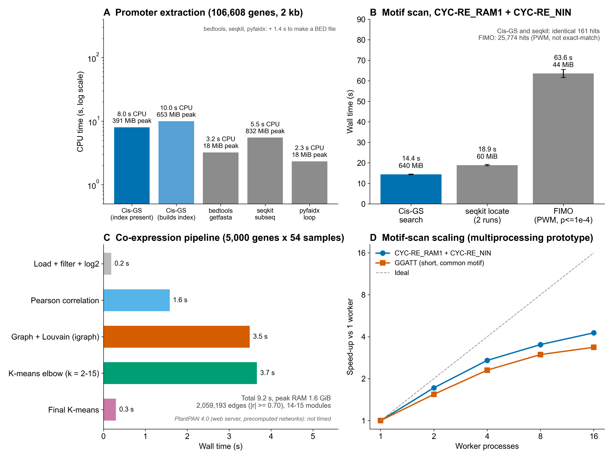

Performance
===========

Cis-GS was benchmarked on the *Arachis hypogaea* Tifrunner genome
(2.6 Gb, 106,608 annotated genes, 2 kb promoters) on one machine: Intel Core
i5-14450HX (16 logical cores), 18 GB RAM, WSL2 Ubuntu, Python 3.11. Every
measurement is a fresh process: one untimed warm-up run, then three timed
runs (mean ± sample standard deviation), all tools in the same session.
Reference tools: bedtools 2.31.1, seqkit 2.14.0, samtools 1.24, pyfaidx
0.9.0.4, MEME Suite 5.5.9. All tools shared one pre-built FASTA index
(``samtools faidx``, 4.3 s once).

Definitions
-----------

* **Wall time** - elapsed real time from the start to the end of a run.
* **CPU time** - processor time used by the run, summed over all cores; it
  exceeds wall time when several cores work in parallel.
* **Peak RAM** - largest amount of memory held in RAM during the run
  (maximum resident set size; 1 MiB = 1,048,576 bytes).

Resources per step
------------------

.. list-table::
   :header-rows: 1
   :widths: 30 26 14 12 18

   * - Step
     - Tool
     - Wall time
     - Peak RAM
     - Note
   * - Promoter extraction
     - Cis-GS 1.3.2.5 (index present)
     - 4.7 ± 0.1 s
     - 391 MiB
     - CPU 8.0 ± 0.1 s; includes GFF3 parse
   * -  
     - Cis-GS 1.3.2.5 (builds index)
     - 6.5 ± 0.1 s
     - 653 MiB
     - CPU 10.0 ± 0.1 s; no .fai file present
   * -  
     - bedtools getfasta
     - 3.7 ± 0.4 s
     - 18 MiB
     - CPU 1.8 ± 0.1 s; plus 1.4 s BED
   * -  
     - seqkit subseq
     - 6.1 ± 1.9 s
     - 832 MiB
     - CPU 4.1 ± 0.2 s; plus 1.4 s BED
   * -  
     - pyfaidx loop
     - 3.2 ± 1.9 s
     - 18 MiB
     - CPU 0.9 ± 0.0 s; plus 1.4 s BED
   * - Motif scan (2 motifs, incl. significance)
     - Cis-GS
     - 14.4 ± 0.1 s
     - 640 MiB
     - 161 hits
   * -  
     - seqkit locate -d (2 runs)
     - 18.9 s
     - 60 MiB
     - 161 hits (identical)
   * -  
     - FIMO, p <= 1e-4
     - 63.6 ± 2.0 s
     - 44 MiB
     - 25,774 PWM hits (different question)
   * - Short motif stress test (GGATT)
     - Cis-GS
     - 12.1 ± 0.2 s
     - 1,180 MiB
     - 442,811 hit rows
   * - Co-expression pipeline (5,000 genes x 54 samples)
     - Cis-GS (igraph)
     - 9.2 ± 0.3 s
     - 1,665 MiB
     - 2.06 M edges, 14-15 modules

Notes
-----

* **Extraction output is identical** across Cis-GS, bedtools, seqkit and
  pyfaidx (same 106,608 sequences).
* bedtools and pyfaidx remain faster in CPU time at pure interval extraction;
  Cis-GS additionally parses the GFF3 and writes the promoter table used by
  later steps. The wall time of the reference tools varied between repetitions
  (file-system latency under WSL2) while their CPU time did not.
* **Cores:** extraction and motif scanning used 1.3-1.7 cores on average (CPU time divided by wall
  time). The co-expression step used about 5.5 cores inside NumPy / scikit-learn.
  A multiprocessing prototype of the scan reached 4.3x with 16 workers; it is
  not part of the release.
* **Memory:** every step stayed under 2 GiB, so the workflow runs on an
  8 GB laptop.
* Louvain community detection is not seeded, so the number of modules varies
  between runs (14-15); K-means is seeded.
* FIMO is listed for timing only: it scores position weight matrices and
  accepts mismatches, whereas Cis-GS matches IUPAC consensus patterns.
* PlantPAN 4.0 and PlantRegMap are web servers with precomputed data for fixed
  species; they cannot be run on these data and are not timed.
